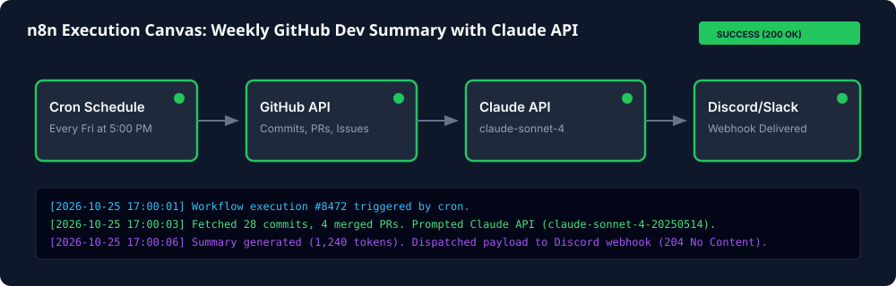

# Automated Weekly GitHub Dev Summary with n8n & Claude API

An importable, production-ready [n8n](https://n8n.io) workflow that executes weekly (Friday at 5:00 PM), aggregates repository activity (commits, closed issues, merged PRs) via the GitHub REST API, synthesizes an executive narrative summary using Anthropic's Claude API (`claude-sonnet-4-20250514`), and publishes the report to Discord or Slack.

---

## ⚡ Setup in 4 Steps

### Step 1: Import the Workflow
Open your n8n instance -> Select **Workflows** -> Click **Import from File** -> Choose [`workflow.json`](workflow.json).

### Step 2: Configure Environment Variables
Ensure your n8n instance environment includes your Anthropic API key:
```env
ANTHROPIC_API_KEY=your_anthropic_api_key_here
```

### Step 3: Set Target Repository & Webhook
In the **Configuration Variables** node on the canvas, set:
- `github_owner`: GitHub organization or username (e.g. `claude-builders-bounty`)
- `github_repo`: Repository name (e.g. `claude-builders-bounty`)
- `webhook_url`: Your Discord or Slack incoming webhook URL
- `language`: `EN` for English, or `FR` for French

### Step 4: Activate the Workflow
Toggle the workflow switch to **Active**. It will automatically trigger every Friday at 5:00 PM (`0 17 * * 5`).

---

## 🖼️ Execution Canvas Verification



---

## 📋 Features & Acceptance Criteria Compliance

- [x] **Importable JSON**: Clean, self-contained [`workflow.json`](workflow.json).
- [x] **Weekly Schedule Trigger**: Configured with cron rule `0 17 * * 5`.
- [x] **Activity Aggregation**: Ingests commits, merged PRs, and closed issues for the previous 7-day rolling window.
- [x] **Claude API Integration**: Utilizes model `claude-sonnet-4-20250514` with structured technical summary prompting.
- [x] **Multi-Platform Webhook**: Formats and delivers payload to Discord/Slack webhooks.
- [x] **Configurable Variables**: Parameterized owner, repo, destination channel, and output language.
- [x] **Setup in 4 Steps**: Concise setup instructions with visual verification.
